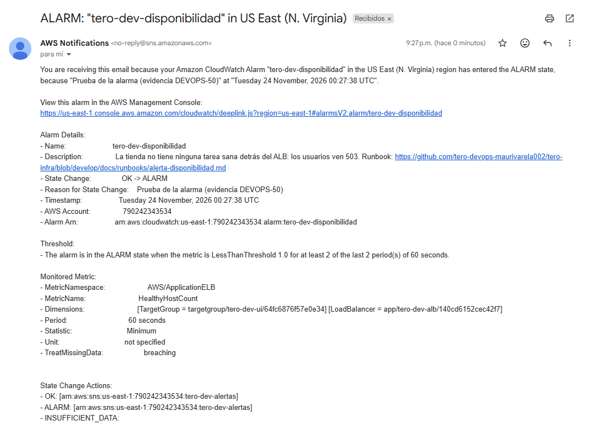
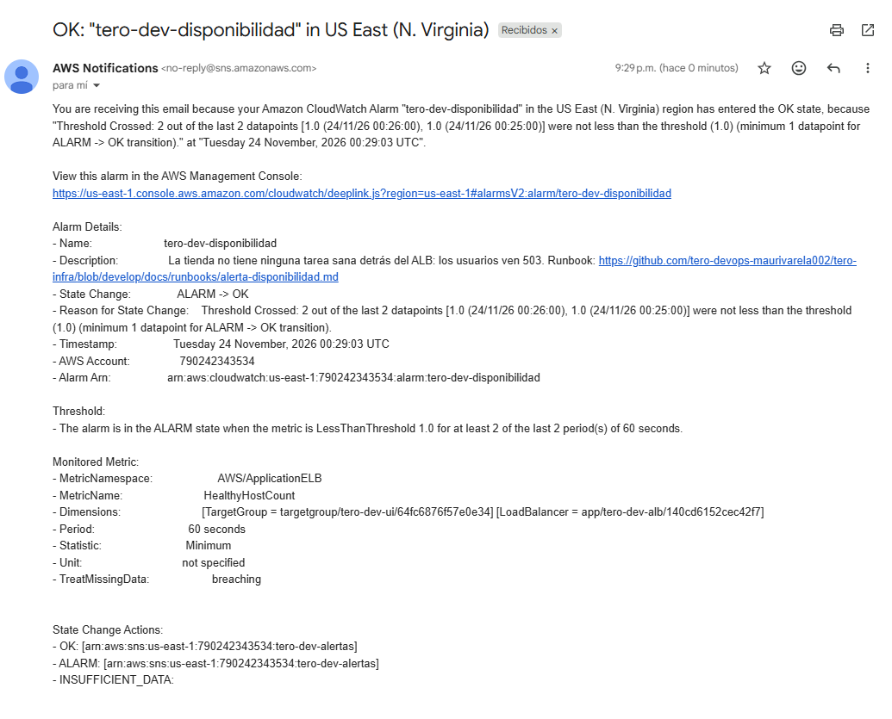

# Evidencias Sprint 4: observabilidad (DEVOPS-49, 50 y 51)

Ambiente: dev (`tero-dev`), 24/11/2026. Todo lo crea Terraform (`modules/monitoring`, PR #13).

## DEVOPS-49: dashboard `tero-dev-operacion`


Arriba, el estado de las 3 alarmas. Después: pedidos por minuto al ALB, latencia
p95/p99 con la línea del umbral de la alarma (1,5 s), errores 5xx y 4xx, tareas
sanas de la tienda (ui), CPU y memoria por servicio y tareas corriendo por
servicio (Container Insights). En la captura la alarma de disponibilidad está
en ALARM por la prueba de abajo.

## DEVOPS-50 y 51: alarma con aviso por mail y runbook

Se forzó la alarma de disponibilidad para probar la cadena completa
(CloudWatch → SNS `tero-dev-alertas` → mail), como indica el runbook
[alerta-disponibilidad.md](../../runbooks/alerta-disponibilidad.md#cómo-probarla-evidencia):

```bash
aws cloudwatch set-alarm-state --alarm-name tero-dev-disponibilidad \
  --state-value ALARM --state-reason "Prueba de la alarma (evidencia DEVOPS-50)"
```

**ALARM** (00:27:38 UTC). El mail trae la descripción con el link al runbook:



**OK** (00:29:03 UTC). CloudWatch volvió a evaluar la métrica real (1 tarea
sana en los 2 últimos minutos) y la alarma se recuperó sola:



Las alarmas de errores 5xx y latencia p95 (DEVOPS-51) usan el mismo topic y se
ven en verde (OK) en el dashboard. A los mails se les recortó el pie con el link
de desuscripción.
